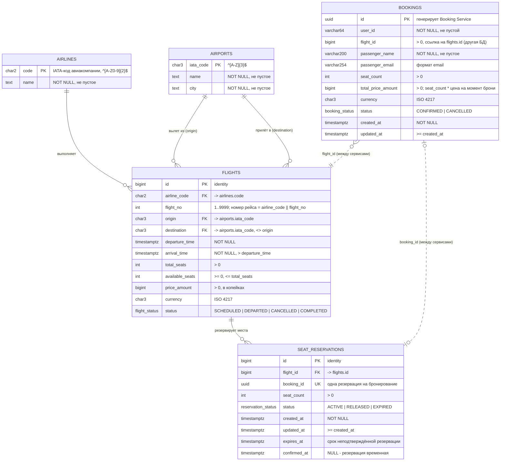

# ER-диаграмма

У каждого сервиса своя БД. Связь `bookings.flight_id → flights.id` и
`seat_reservations.booking_id ↔ bookings.id` логическая (между разными БД
внешних ключей нет), поэтому на диаграмме она пунктирная.

## Ограничения целостности

| Таблица | Ограничение |
|---|---|
| `flights` | `available_seats >= 0`, `available_seats <= total_seats`, `total_seats > 0`, `price_amount > 0` |
| `flights` | `origin <> destination`, `arrival_time > departure_time` |
| `flights` | `UNIQUE (airline_code, flight_no, (departure_time AT TIME ZONE 'UTC')::date)` — номер рейса + дата вылета уникальны |
| `seat_reservations` | `seat_count > 0`, `UNIQUE (booking_id)`, `updated_at >= created_at` |
| `seat_reservations` | активная резервация либо подтверждена (`confirmed_at`), либо имеет срок (`expires_at`); `confirmed_at >= created_at`, `expires_at > created_at` |
| `bookings` | `seat_count > 0`, `total_price_amount > 0`, формат email, `updated_at >= created_at` |
| справочники | формат IATA-кодов (`^[A-Z]{3}$` для аэропортов, `^[A-Z0-9]{2}$` для авиакомпаний) и ISO 4217 для валют |

## 3NF

- **1NF.** Все атрибуты атомарны. Номер рейса не хранится строкой `"SU1234"`:
  он разложен на `airline_code` + `flight_no`.
- **2NF.** Во всех таблицах суррогатный первичный ключ из одного столбца
  (`id`, `code`, `iata_code`), поэтому частичных зависимостей от составного ключа нет.
  Альтернативный ключ рейса — `(airline_code, flight_no, дата вылета)`. Если бы
  хранилась строка `"SU1234"`, `airline_code` зависел бы от её части, и это
  нарушило бы 2NF. Поэтому номер разложен.
- **3NF.** Нет транзитивных зависимостей от ключа:
  - название авиакомпании зависит от `airline_code`, поэтому вынесено в `airlines`;
  - название и город аэропорта зависят от IATA-кода, поэтому вынесены в `airports`;
  - в `seat_reservations` нет данных рейса, только `flight_id`;
  - `bookings.total_price_amount` не вычисляется из других атрибутов строки:
    это снимок цены на момент бронирования (цена рейса потом может измениться),
    а не производное поле.
  - Дата вылета отдельно не хранится: для уникальности используется индекс
    по выражению от `departure_time`.
